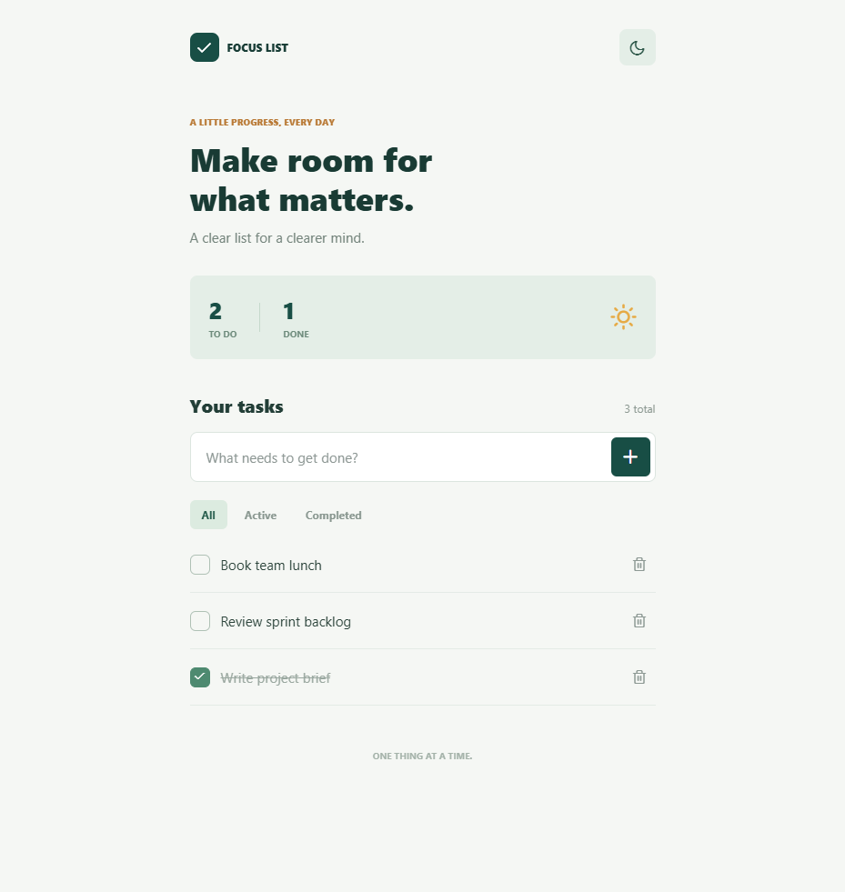
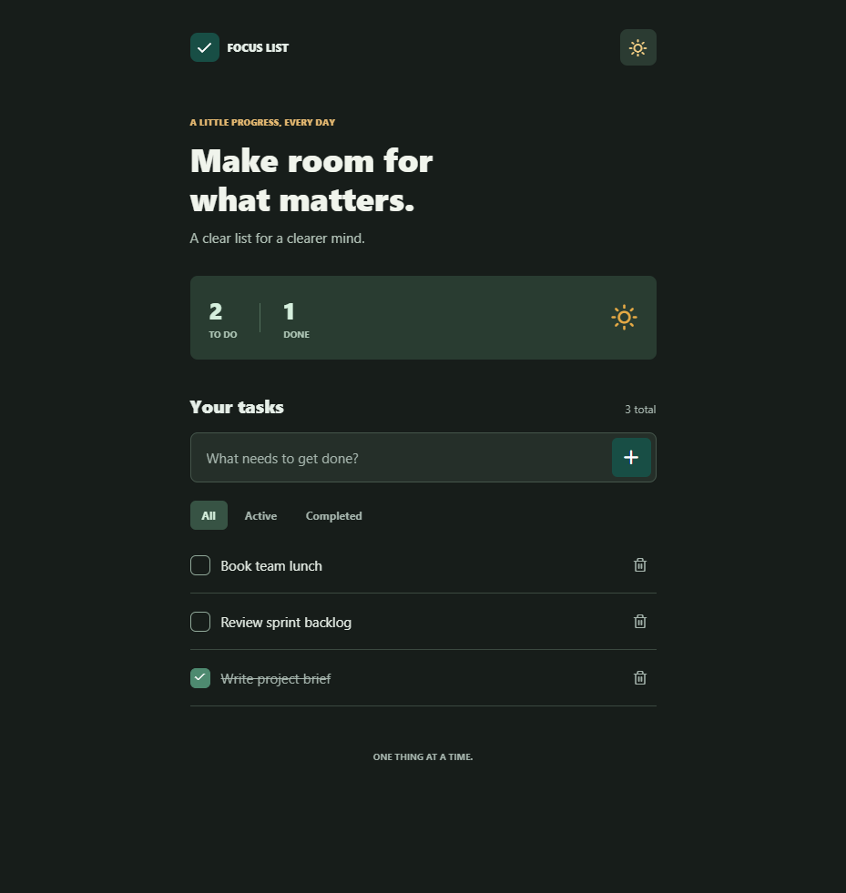

# Focus List: Spec Kit walkthrough

A small Expo / React Native todo app, initialized with Spec Kit for GitHub Copilot. Use this repository to run the app in a browser and try the Spec Kit workflow yourself.

> [!NOTE]
> This is an independent educational example, not an official Spec Kit document, and it is not reviewed or endorsed by GitHub. The `workshop-artifacts/` files are hand-written teaching references, not outputs claimed to be generated by an agent. Your generated specs, plans, and code will differ. Review everything before you rely on it.

In this walkthrough you will:

1. Run the app in the browser and check its tests.
2. Look at the Spec Kit files already installed in this repository.
3. Use Spec Kit's slash commands in GitHub Copilot Chat to add one feature: task priority.
4. Review the generated artifacts, implement, and verify the result yourself.

Spec Kit is a set of commands that guide an agent through specification, planning, task breakdown, and implementation. The commands run inside your coding agent (here, Copilot Chat), not in the terminal.

## Prerequisites

- Node.js LTS and npm, with network access for the first install
- Visual Studio Code with GitHub Copilot Chat enabled
- Git

## Part 1: Run the app in the browser

Clone and open the repository:

```powershell
git clone https://github.com/nashtech-garage/focus-list-speckit-walkthrough.git
cd focus-list-speckit-walkthrough
```

Install dependencies, run the tests, and start the web version:

```powershell
npm ci
npm test
npm run web
```

Open the URL printed by Expo in your browser. Add, complete, filter, and delete a few tasks, then reload the page. Tasks are stored in the browser on this device only, so they are not shared between browsers or devices. To reset, delete tasks in the app or clear this site's browser storage.

`npm test` runs `src/tasks.test.js`, which covers the pure list operations in `src/tasks.js`. It should report 2 passing tests.

**Checkpoint:** the app runs in the browser and `npm test` passes.

What you should see in the browser (light and dark mode, with a few sample tasks):

| Light mode | Dark mode |
|---|---|
|  |  |

## Part 2: Look at the Spec Kit scaffold

This repository has already been initialized using `specify init --here --force --non-interactive --integration copilot --script ps`; `.github/skills/` and `.specify/` contain the real scaffold. Open the repository root in VS Code, enable GitHub Copilot Chat, and use the skills there. Restart or reload VS Code if the skills are not discovered. The project constitution is already populated.

Look at these locations before you run any command:

| Path | Purpose |
|---|---|
| `.specify/memory/constitution.md` | Project principles. Already populated. |
| `.specify/templates/` | Templates for spec, plan, tasks, checklist, and constitution. |
| `.specify/scripts/powershell/` | Helper scripts used by the commands. |
| `.github/skills/speckit-*/SKILL.md` | The skills that Copilot Chat discovers as `/speckit-*` commands. |
| `workshop-artifacts/` | A reference spec and plan for the base app, written by hand. |

The Spec Kit commands used in this walkthrough are:

```text
/speckit-constitution
/speckit-specify
/speckit-plan
/speckit-tasks
/speckit-implement
/speckit-converge
```

Run each in Copilot Chat, not PowerShell. Review the generated artifacts between stages. Do not run initialization with `--force` in an existing project without checking what it may overwrite.

**Checkpoint:** you can find the constitution and at least one skill file. If `/speckit-*` commands do not appear in Copilot Chat, reload the VS Code window.

## Part 3: Add a feature with Spec Kit

We will add **task priority**: each task is either `Normal` or `High`, and the list can be filtered by priority. Run each command in Copilot Chat, one at a time, and review the output before you move on.

### 3.1 Constitution (review only)

```text
/speckit-constitution
```

The constitution is already populated, so you only need to review it. Ask whether any principle conflicts with the new feature. Do not rewrite it unless you have a reason.

### 3.2 Specify

```text
/speckit-specify Add a priority to each task. A task is Normal by default and can be set to High. Users can filter the list by priority. Existing tasks saved without a priority must still load and show as Normal. Keep the existing behavior for capture, completion, filtering by status, and deletion.
```

Compare the result with `workshop-artifacts/focus-list-spec.md`. Check that:

- user stories and acceptance criteria are testable,
- the spec describes behavior, not implementation,
- old stored data without a priority is covered.

### 3.3 Plan

```text
/speckit-plan Use the existing React Native and Expo setup. Keep list logic in src/tasks.js so it can be tested with node --test.
```

Check that the plan names the files it will change, and that it does not add dependencies you did not ask for.

### 3.4 Tasks

```text
/speckit-tasks
```

Check that tasks are small, ordered, and include tests for the logic in `src/tasks.js`.

### 3.5 Implement

```text
/speckit-implement
```

Review the file diffs. Do not accept changes you do not understand.

### 3.6 Converge

```text
/speckit-converge
```

If it reports remaining work, run `/speckit-implement` and `/speckit-converge` again until it reports converged. Convergence is a report, not proof that the app is correct.

**Checkpoint:** each artifact has been reviewed, and you can explain every change in the diff.

## Part 4: Verify the result yourself

Do not trust the agent's summary. Check the result directly:

```powershell
npm test
npx expo install --check
npm run web
```

In the running app, check these cases:

- Add a `High` task and a `Normal` task. Both appear with the right priority.
- Change a task's priority and reload the page. The change is kept.
- Load a task saved before this feature (no priority field). It should show as `Normal`.
- Filter by priority. Empty results show an empty state, not an error.
- Each control has an accessible label.

Deliberately challenge at least one assumption the agent made. For example, ask what happens when storage fails, or when the title is whitespace only.

**Checkpoint:** tests pass and the manual cases above work.

## Troubleshooting

- **The web app does not start:** run `npm ci`, then `npx expo install --check`.
- **Skills do not appear in Copilot Chat:** open the repository root in VS Code and reload the window.
- **Tests fail after an agent change:** read the failing test first. Decide whether the code or the test expectation is wrong before editing anything.
- **Running out of time:** use the reference files in `workshop-artifacts/` to read a complete example instead of generating one.

## Structure

- `App.js`: interface, hydration, and local persistence.
- `src/tasks.js` / `src/tasks.test.js`: pure list operations and focused tests.
- `.specify/`, `.github/skills/`: installed Spec Kit scaffold.
- `workshop-artifacts/`: facilitator-prepared example spec and plan.

## Known limitations

This is an educational local-only app, not a production product. No synchronization, authentication, reminders or encryption. Storage failures display a warning; the current session is not persisted after a failure. The dependency audit on 2026-11-11 reported four moderate advisories in Expo's transitive tooling dependency chain. Re-run `npm audit` and evaluate updates before production use; do not use a forced major downgrade blindly.

## Reference

- [GitHub Spec Kit](https://github.com/github/spec-kit)
- [Community walkthroughs](https://github.com/github/spec-kit/blob/main/docs/community/walkthroughs.md)